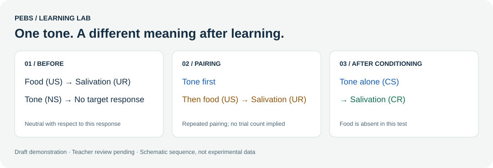
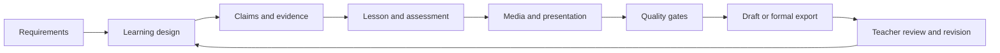

# PEBS · Psychology Education Build System

**A skill-based workflow for psychology course design, evidence review and teaching materials.**

[English](README.md) · [简体中文](README.zh-CN.md) · [日本語](README.ja.md) · [한국어](README.ko.md)

[](https://github.com/Beritwu/psychology-education-skills/actions/workflows/ci.yml)


[**Try the interactive lesson →**](https://beritwu.github.io/psychology-education-skills/)
 · [Sample course](examples/classical-conditioning/course.zh-CN.md)
 · [Complete usage guide](docs/usage.md)
 · [中文使用手册](docs/usage.zh-CN.md)



## What is PEBS?

PEBS is a local Python application for psychology educators, teacher trainers,
and curriculum teams. It connects requirements, learning design, empirical claims,
source evidence, lesson materials, media planning, quality checks, and exports in
one revision-aware workflow. It includes a web workbench, CLI and REST API.

The catalog contains **22 built-in skills and 14 optional external teaching
skills**. External skills are installed and verified through the provider lifecycle.

## What can you do?

| Task | Capability |
|---|---|
| Plan a course | Goals, assessments, teaching sequence, cases and worksheets |
| Check factual claims | Research search, stored source snapshots, locatable quotations and review states |
| Produce teaching materials | Lesson plans, narration, student/teacher materials, SVG diagrams and editable PPTX |
| Revise selectively | Change a section, preserve another, and track dependent artifacts |
| Control delivery | Current applicable quality gates; draft labeling when formal criteria are unmet |
| Evaluate the workflow | Benchmarks, skill/version traces, frozen teacher-evaluation packages and edit-ratio records |



## Quick start

Python 3.11+ is required; Python 3.12 is the recommended starting point.

```bash
git clone https://github.com/Beritwu/psychology-education-skills.git
cd psychology-education-skills
python -m venv .venv
```

Activate the environment: Windows PowerShell `.venv\Scripts\Activate.ps1`;
macOS/Linux `source .venv/bin/activate`. Then:

```bash
python -m pip install -r requirements.txt
python -m pebs.cli serve --port 8710
```

Open **http://127.0.0.1:8710**. The UI and static sample can be explored without a
model, but real course generation needs a configured provider. The default
`config/providers.yaml` uses a locally installed and logged-in Codex CLI;
`openai_compatible` is the alternative. See [provider setup](docs/usage.md#2-configure-providers).

```bash
python -m pebs.cli build --project first_course --planner dynamic --max-model-calls 20 --max-research 8 --max-seconds 900 --request "Create one introductory psychology lesson with a fictional case and a formative question. No PPT and no animation."
```

Inspect the returned changeset in the UI before accepting it. Generation consumes
the configured provider's quota. Provider status is a preflight check, not a
guarantee that a request will succeed.

## Optional teaching skills

The 14 external skills come from [Gareth Manning's Education Agent Skills](https://github.com/GarethManning/education-agent-skills),
pinned to `6bbbce41…`. Three adaptations add PEBS policies and artifact contracts.
The checked-in registry is a catalog; ignored runtime caches are not distributed.

On a fresh clone, install the pinned provider and verify it:

```bash
python -c "from pebs.provider_edu import install; install()"
python -c "from pebs.provider_edu import verify; r=verify(); print(r); raise SystemExit(0 if r['ok'] else 1)"
```

This downloads the pinned archive, applies the manifest's recorded review policy,
publishes/pins the selected skills and applies the included patches. It does not
execute upstream scripts. Inspect the provider manifest before adopting it.
See the [skill lifecycle](docs/usage.md#6-skills-and-portability) for custom imports
and reinstalling existing caches. Built-ins remain the default selection.

## Example: classical conditioning

The [sample package](examples/classical-conditioning/README.md) contains a 20-minute
lesson, learner worksheet, answer key, skill-design evidence, storyboard and a
four-language interactive animation. Open `examples/classical-conditioning/index.html`
directly in a browser; it works offline without keys or build tools.

The example applies backwards design, hinge-question design and dual coding.
The package includes skill provenance, a storyboard, and an offline browser
animation with playback and step controls.

## Documentation and development

| Resource | Contents |
|---|---|
| [Usage guide](docs/usage.md) / [中文手册](docs/usage.zh-CN.md) | Installation, configuration, builds, revisions, export, API, evaluation and troubleshooting |
| [Architecture](documentation/architecture.md) | Components, trust boundaries and operational documentation |
| [Skills catalog](docs/skills.md) | Registered skills, contracts and upstream provenance |
| [Evaluation workflow](docs/evaluation-workflow.md) | AI cross-audit and the real-teacher path |
| [Roadmap](docs/roadmap.md) | Implemented scope and remaining validation |
| [Contributing](CONTRIBUTING.md) | Development and review rules |
| [Security](SECURITY.md) | Deployment scope and vulnerability reporting |
| [Changelog](CHANGELOG.md) | Release history |

```bash
python -m compileall -q pebs
python -m pytest tests -q -m "not integration and not live_research"
python -m pytest tests -q -m benchmark_smoke
```

CI checks code behavior; live research and classroom evaluation are separate.
See [test coverage and gaps](documentation/tests.md).

## License and acknowledgments

Original PEBS code and documentation: [MIT](LICENSE). Education Agent Skills
adaptations and the example's educational content: **CC BY-SA 4.0**. These are
separate scopes; the MIT license does not relicense upstream material.
See [third-party notices](THIRD_PARTY_NOTICES.md) for attribution and dependencies.
