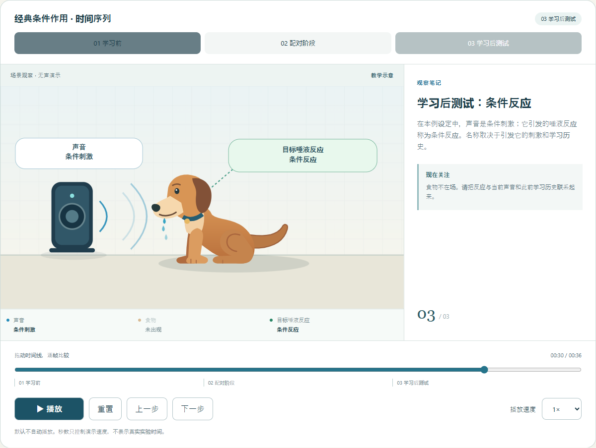

# PEBS · 心理学教育课程构建系统

**让课程的证据可追溯、修改有范围、交付可复核。**

[English](README.md) · [简体中文](README.zh-CN.md) · [日本語](README.ja.md) · [한국어](README.ko.md)

[](https://github.com/Beritwu/psychology-education-skills/actions/workflows/ci.yml)


**心理学教学单元：** 查看[操作性条件作用与心理学研究方法](examples/two-psychology-units/current-course-materials/README.md)，包含课堂材料、诊断题与真人教师审核流程。

[**打开交互课程与动画 →**](https://beritwu.github.io/psychology-education-skills/)
 · [示例教案](examples/classical-conditioning/course.zh-CN.md)
 · [完整中文使用手册](docs/usage.zh-CN.md)



## 它是什么？

PEBS 面向心理学教师、教师培训者和课程开发团队，把需求、教学设计、心理学论断、证据、
课程材料、媒体规划、质量检查与导出连接起来。它提供本地网页工作台、命令行和 REST API。

当前目录包含 **22 个内置技能和 14 个可选外部教学技能**。完整系统还包括运行器、资料库、
版本管理和交付检查。换电脑时需要安装依赖及外部技能资源，不能只复制一份 SKILL.md。

## 能做什么？

| 任务 | 功能 |
|---|---|
| 设计课程 | 学习目标、评价任务、教学过程、案例、练习与工作纸 |
| 核查心理学论断 | 学术检索、来源快照、可定位引文和待核验状态 |
| 生产成套材料 | 教案、讲稿、师生材料、SVG 图示及可编辑 PPTX |
| 局部修改 | 修改指定部分、保护保留部分、追踪关联材料的过期状态 |
| 控制交付 | 检查适用的质量门禁；未满足正式条件时标记草稿 |
| 评价与改进 | 基准对比、技能版本记录、冻结的教师评价包和真实修改比例 |

流程：**需求 → 学习设计 → 论断与证据 → 教案和评价 → 媒体 → 质量检查 → 导出 → 教师复核。**

## 快速开始

需要 Python 3.11 或更新版本，建议使用 Python 3.12。

```bash
git clone https://github.com/Beritwu/psychology-education-skills.git
cd psychology-education-skills
python -m venv .venv
```

Windows PowerShell：`.venv\Scripts\Activate.ps1`。
macOS/Linux：`source .venv/bin/activate`。

```bash
python -m pip install -r requirements.txt
python -m pebs.cli serve --port 8710
```

浏览器访问 **http://127.0.0.1:8710**。工作台和静态示例可以先打开；真实生成课程需要模型服务。
默认 `config/providers.yaml` 使用本机已经安装并登录的 Codex CLI，也支持 `openai_compatible`。
配置方法、密钥环境变量和故障处理见[使用手册](docs/usage.zh-CN.md)。真实调用会消耗服务配额。

```bash
python -m pebs.cli build --project first_course --planner dynamic --max-model-calls 20 --max-research 8 --max-seconds 900 --request "设计一节心理学入门课，包含虚构案例和形成性评价题，不需要PPT，不要动画。"
```

构建后先在工作台查看变更集和差异，再接受或拒绝。接受变更不等于通过正式交付验收。

## 安装可选教学技能

14 个外部技能来自 [Gareth Manning 的 Education Agent Skills](https://github.com/GarethManning/education-agent-skills)，
固定于 `6bbbce41…`，其中 3 个附有项目政策与输出契约补丁。Git 仓库包含目录和补丁，不包含本机运行缓存。

首次克隆后执行：

```bash
python -c "from pebs.provider_edu import install; install()"
python -c "from pebs.provider_edu import verify; r=verify(); print(r); raise SystemExit(0 if r['ok'] else 1)"
```

安装器下载固定版本，按 provider 清单中已记录的审核政策导入、发布、固定版本并应用补丁，
不会执行上游脚本。采用前请阅读清单。自定义导入和重新安装见手册；内置技能仍是默认选择。

## 示例课程与动画

[示例材料包](examples/classical-conditioning/README.md)包括 20 分钟教案、学习者工作纸、教师答案、
技能应用记录、分镜和支持四种语言的交互动画。直接打开 `examples/classical-conditioning/index.html`
即可离线体验，不需要 API Key。

示例采用逆向设计、诊断性提问和双重编码技能，附有设计记录与来源。
网页动画支持播放、暂停、逐步查看和静态图，可配合教案使用。

## 文档与开发

- [中文完整使用手册](docs/usage.zh-CN.md) / [English guide](docs/usage.md)
- [技能目录与来源](docs/skills.md)
- [架构与运行边界](documentation/architecture.md)
- [交叉审计与真人教师评价](docs/evaluation-workflow.md)
- [路线图](docs/roadmap.md) · [贡献指南](CONTRIBUTING.md) · [安全说明](SECURITY.md)
- [测试覆盖与缺口](documentation/tests.md) · [更新记录](CHANGELOG.md)

```bash
python -m compileall -q pebs
python -m pytest tests -q -m "not integration and not live_research"
python -m pytest tests -q -m benchmark_smoke
```

自动化检查验证软件行为，不证明课堂教学效果。

## 许可证与致谢

原创代码和文档使用 [MIT](LICENSE)。外部教学技能改编以及示例中的教育文本使用 **CC BY-SA 4.0**。
MIT 不改变上游内容的许可证。完整来源和适用范围见[第三方声明](THIRD_PARTY_NOTICES.md)。
